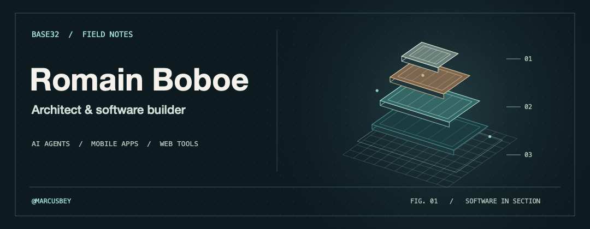

# Romain Boboe

I’m an architect, software developer, and founder of **Base32**. I build AI agents, mobile apps, and web tools. Architecture still shapes how I work: I sketch the system, build a small version, and see what happens when someone uses it.

[Portfolio](https://www.romainboboe.com/) · [GitHub repositories](https://github.com/marcusbey?tab=repositories)

## What I build

| Project | What it does |
|---|---|
| [Compozit Vision](https://apps.apple.com/us/app/id6752837860) | Turns room photos into design proposals. It brings my architecture and software work together. |
| [GluteTime](https://apps.apple.com/us/app/glutetime-squat-to-unlock/id6818056676) | Trades squats for scroll time. Your selected apps unlock after you finish a set. |
| [RecopyFast](https://www.recopyfa.st/) | Gives agency clients a way to edit website copy without asking for another deploy. |
| [HelloAnna](https://www.helloanna.app/) | An AI assistant in development for turning source material into content drafts that people can review and approve. |
| [OpenFlows](https://openflows.ai/) | AI workflows for architecture firms, from finding project information to organizing repetitive office work. |
| Base32 Company OS | The internal control center I use to track products, monitor deployments, and coordinate agents. |
| [Base32 Studio](https://base32.studio/) | Websites for local businesses. |

## The stack behind the work

| Where I use it | Tools |
|---|---|
| Mobile products | TypeScript, React Native, Expo, Swift, Apple Screen Time |
| Web apps | React, Next.js, TanStack Start, Tailwind CSS |
| Agents and automation | TypeScript, Python, Cloudflare Workers, LangGraph |
| Data, infrastructure and billing | Supabase, PostgreSQL, Vercel, Stripe, RevenueCat |
| Architecture and spatial design | Rhino, Grasshopper, SketchUp |

More projects

- **CafeLingo** — language practice through voice calls.
- **QuizSmart** — turns study documents into quizzes.
- **Spatial Dynamics Engine** — an experiment in shaping architectural programs through simulation.

